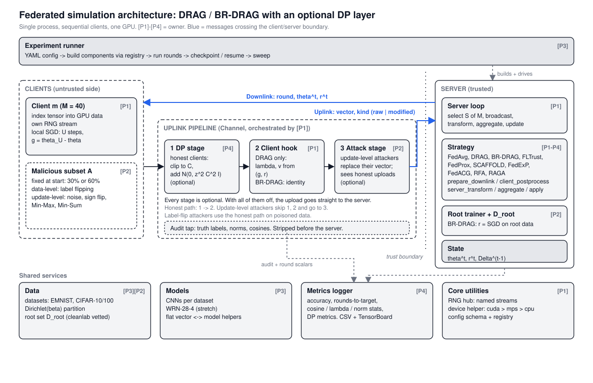

# Capstone-team_07
## Domain: Federated learning

### Problem statement: 

DRAG and BR-DRAG reduce client drift and resist Byzantine attacks in federated learning, but both assume clients upload unperturbed updates. When clients add differential privacy noise, the cosine and norm signals these methods depend on are distorted, and their guarantees no longer clearly apply. This project measures how much accuracy and robustness are lost under client-side differential privacy and momentum filtering, and proposes modifications to recover them.

base paper:  [arXiv 2601.06903](https://arxiv.org/abs/2601.06903)

## Project status

We are reproducing the DRAG and BR-DRAG algorithms from [arXiv 2601.06903](https://arxiv.org/abs/2601.06903), then testing them under client-side differential privacy, then proposing improvements. Implementation has not started yet; so far we have done the setup and the design.

- [x] Cross-platform environment setup (`SETUP.md`, `setup.ps1`, `setup.sh`, `check_env.py`)
- [x] Architecture decision and design document (`docs/architecture.md`)
- [x] Architecture and per-round sequence diagrams (`docs/diagrams/`)
- [x] Branch protection on `main` (pull request and one approval required)
- [ ] Phase 0: contracts and package scaffold
- [ ] Phase 1: FedAvg end to end
- [ ] Phase 2: DRAG, BR-DRAG, attacks, baselines
- [ ] Phase 3: reproduce the paper's results
- [ ] Phase 4: experiments with differential privacy
- [ ] Phase 5: improvements

## Approach

We chose a modular, single-process simulation: Server, Client, Strategy, Attack, Privacy, Data and Metrics are separate modules that talk only through small message objects. Differential privacy is an optional stage on the client's upload path, so a non-DP run and a DP run use the same code and can be compared seed for seed.

Full design, interfaces, metrics and open decisions: [docs/architecture.md](docs/architecture.md)

## Team and responsibilities

| Person | Name | Focus |
|---|---|---|
| 1 | Poojitha | DRAG, core skeleton and FedAvg |
| 2 | Saurav | BR-DRAG, root trainer, attacks, FLTrust |
| 3 | Nishanth | Datasets, models, experiment runner, drift baselines |
| 4 | Sunidhi | Differential privacy, metrics, RFA and RAGA baselines |

## Getting started

See [SETUP.md](SETUP.md) for Windows, macOS and Linux setup.

## Workflow

- `main` is protected: all changes go through a pull request with at least one approval.
- Work on a branch named `feat/<area>-<name>` (or `docs/<name>` for documentation).
- Files that define the shared interfaces (listed in `docs/architecture.md`, section 10) need approval from all four of us.
