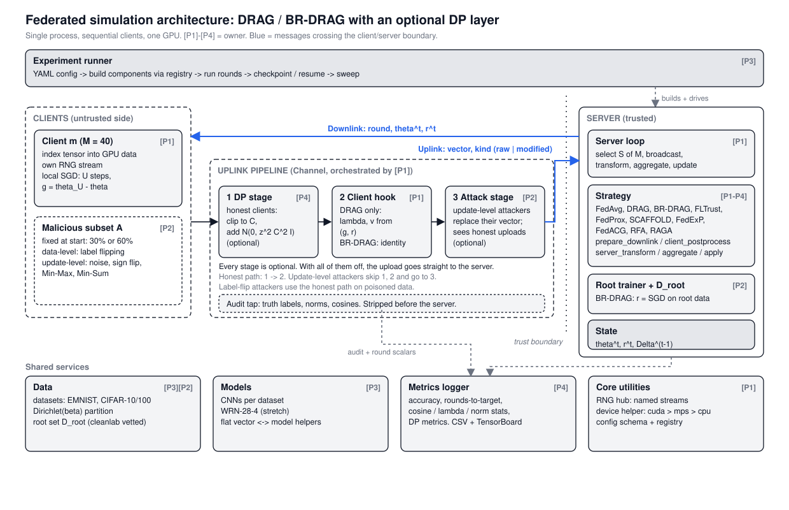
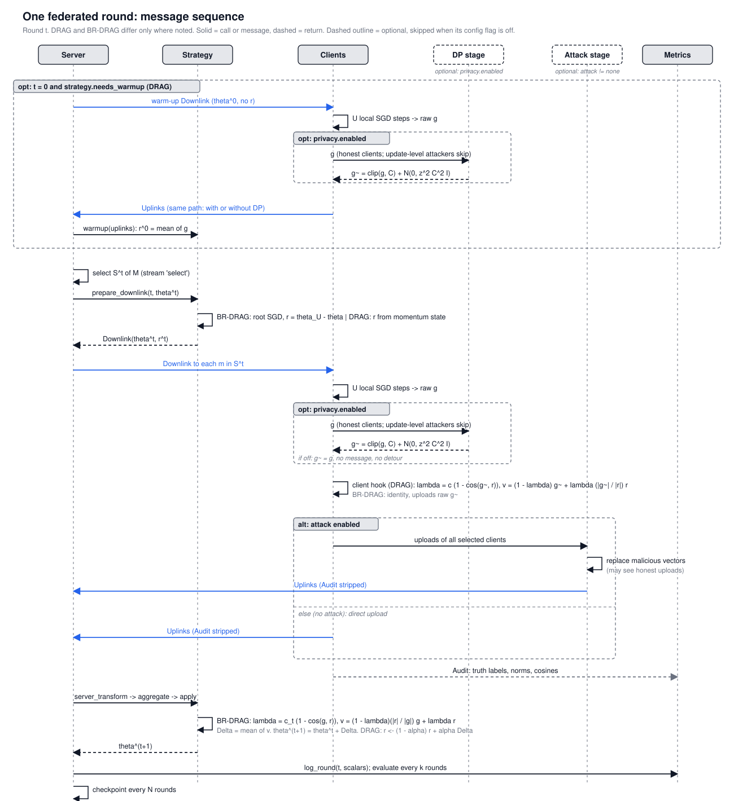

# Architecture: DRAG / BR-DRAG Federated Learning Simulation

Capstone-team_07 | base paper: arXiv 2601.06903 | status: **draft v0.1, for team review**

> **How to use this document.** Section 3 and 6 give the picture, section 5 gives the interfaces everyone codes against, section 10 says who owns what, section 15 lists decisions we still have to close. Read sections 3, 5, 6 and your own part of 10 before writing code.
>
> **Where it lives.** Put this file at `docs/architecture.md` and the diagrams in `docs/diagrams/` (the image links below are relative to that location).

---

## 1. Purpose and scope

We are doing three things, in this order:

1. **Reproduce** the paper's DRAG (client drift) and BR-DRAG (Byzantine-robust) algorithms exactly as published.
2. **Test them under client-side differential privacy (DP)** and measure how accuracy and robustness change. The problem statement in our README: both methods assume unperturbed uploads, and DP noise distorts the cosine and norm signals they depend on.
3. **Propose and test improvements** that recover what DP and momentum filtering cost.

The architecture must therefore make three phases cheap: the as-is algorithm, DP as a plug-in (not a rewrite), and improvements as new strategy files (not edits to the originals).

**Out of scope:** real networking, multi-GPU, a deployed system. This is a single-process simulation; the interfaces are drawn so it could be wrapped in networking later.

**Chosen design: modular simulation with a strict interface layer.** Server, Client, Strategy, Attack, Privacy, Data and Metrics are separate modules that talk only through small message objects.
---

## 2. What the paper specifies (implementation spec)

Notation: `M` clients, `S` selected per round, `U` local steps, `theta^t` global model, `g_m` = `theta_m^(t,U) - theta^t` (the local update, a flat vector), `r^t` reference direction, `cos(a,b)` cosine similarity.

### FedAvg (baseline and shared skeleton)

```
theta^(t+1) = theta^t + (1/S) * sum_m g_m
```
Plain unweighted mean. No weighting by sample count anywhere in the paper.

### DRAG (client drift)

Round 0 is special. The first reference direction is the mean of the first raw updates.

```
r^0 = (1/S) * sum_m g_m^0                      (warm-up pass, see 15 #1)
r^t = (1-alpha) r^(t-1) + alpha * Delta^(t-1)  for t >= 1,  Delta = (1/S) sum v_m
```
Client side, after local training (this is the **client hook**):
```
lambda_m = c * (1 - cos(g_m, r^t))             in [0, 2c]
v_m      = (1 - lambda_m) * g_m + lambda_m * (||g_m|| / ||r^t||) * r^t
```
Server: `Delta^t = mean(v_m)`, `theta^(t+1) = theta^t + Delta^t`. Clients upload `v` (kind = `"modified"`).

### BR-DRAG (Byzantine-robust)

Clients cannot be trusted to do the correction, so the **server** does it (the **server hook**). The server has a small trusted root dataset `D_root` (3,000 samples).
```
r^t      = theta^(t,U) - theta^t               server runs U SGD steps from theta^t on D_root
lambda_m = c_t * (1 - cos(g_m, r^t))
v_m      = (1 - lambda_m) * (||r^t|| / ||g_m||) * g_m + lambda_m * r^t
theta^(t+1) = theta^t + (1/S) * sum_m v_m
```
Clients upload raw `g` (kind = `"raw"`). Because each `v` is built from `g/||g||` scaled to `||r||`, the norm of `v` is bounded by `||r||` when `lambda <= 1` (i.e. `c_t <= 0.5`). That bound is a good unit test (section 11).

### Paper settings we default to

| Item | Value |
|---|---|
| Clients `M` / per round `S` | 40 / 10 |
| Local steps `U`, batch `B`, lr `eta` | 5, 10, 0.01 |
| Rounds | up to 4000 (EMNIST/CIFAR-10 shorter, check per figure) |
| Heterogeneity | Dirichlet `beta` in {0.1, 0.5} |
| DRAG | `alpha = 0.25`, `c` in {0.1, 0.25} |
| BR-DRAG | `c_t = 0.5`, `D_root` = 3000 samples, class-balanced, vetted with cleanlab |
| Malicious | 30% (and 60%) of the 40 clients |
| Attacks | noise injection, sign flipping, label flipping, Min-Max, Min-Sum |
| Datasets | EMNIST balanced (47 classes), CIFAR-10, CIFAR-100; WRN-28-4 for the larger runs |
| Baselines | FedAvg, FedProx (mu=0.2), SCAFFOLD, FedExP (eps=0.001), FedACG (beta=0.2, lambda=0.85); robust: FLTrust, RFA, RAGA |

Values the paper leaves open are in section 15.

---

## 3. Architecture overview



Four ideas hold the design together:

1. **Only messages cross the client/server boundary.** A `Downlink` goes out, an `Uplink` comes back. A strategy running on the server never sees ground truth (which client is malicious, the pre-noise vector). That information goes to the metrics logger through a separate `Audit` record.
2. **A strategy has two hooks, not one.** DRAG corrects on the client (`client_postprocess`); BR-DRAG corrects on the server (`server_transform`). Everything else (aggregate, apply, state) is shared.
3. **The uplink is an ordered pipeline.** DP stage, client hook, attack stage, in that order, orchestrated by the `Channel`. The order is part of the contract (section 6).
4. **Everything is selected by name from a YAML config.** The experiment matrix (algorithm x attack x beta x dataset x DP level) is a list of config files, not code branches.

---

## 4. Repository layout

The repo currently has `src/`, the setup scripts, `requirements.txt`, `check_env.py`. Proposed layout (new items marked). Package name `fedrag`.

```
Capstone-team_07/
├── src/fedrag/
│   ├── core/                  # P1: the contract layer
│   │   ├── messages.py        #   Downlink, Uplink, Audit
│   │   ├── strategy.py        #   Strategy ABC (hooks)
│   │   ├── server.py          #   round loop
│   │   ├── client.py          #   local SGD
│   │   ├── channel.py         #   ordered uplink pipeline
│   │   ├── registry.py        #   name -> class
│   │   ├── rng.py             #   named RNG streams, save/restore
│   │   ├── vec.py             #   flatten/unflatten, cosine, norms
│   │   └── device.py          #   cuda -> mps -> cpu helper
│   ├── strategies/            # one file per algorithm
│   │   ├── fedavg.py, drag.py                       # P1
│   │   ├── br_drag.py, fltrust.py                   # P2
│   │   ├── fedprox.py, scaffold.py,
│   │   │   fedexp.py, fedacg.py                     # P3
│   │   └── rfa.py, raga.py (+ geomed.py)            # P4
│   ├── attacks/               # P2: base.py, noise.py, sign_flip.py,
│   │                          #     label_flip.py, min_max.py, min_sum.py
│   ├── privacy/               # P4: clip.py, mechanisms.py, accountant.py, dp_stage.py
│   ├── data/                  # P3: datasets.py, partition.py ; P2: root.py
│   ├── models/                # P3: cnn_*.py, wrn28_4.py
│   ├── metrics/               # P4: logger.py, diagnostics.py, dp_metrics.py
│   └── runner/                # P3: run.py, sweep.py, config.py, checkpoint.py
├── configs/                   # paper/, attacks/, dp/   (YAML)
├── tests/                     # mirrors src/fedrag
├── notebooks/                 # thin launchers only (Colab/Kaggle)
├── docs/                      # this file and diagrams/
├── pyproject.toml             # NEW, minimal, so `pip install -e .` works everywhere
└── results/                   # NEW; keep metrics CSVs, ignore *.pt
```

Minimal `pyproject.toml` (Person 1 adds this in the first PR so imports work the same on Windows, macOS, Linux, Colab, Kaggle):

```toml
[build-system]
requires = ["setuptools>=68"]
build-backend = "setuptools.build_meta"

[project]
name = "fedrag"
version = "0.1.0"
requires-python = ">=3.10"

[tool.setuptools.packages.find]
where = ["src"]
```

Add to `.gitignore`: `*.pt`, `results/**/ckpt*`. Small `metrics.csv` files may be committed so results are shared.

No DP library is in `requirements.txt` (no Opacus). We write clipping, noise and the accountant ourselves; they are small. If we later want per-sample DP-SGD, we add a dependency by PR (see section 14).

---

## 5. Contracts (frozen after the Phase 0 PR)

These are the shared interfaces. **Changing any file marked [contract] needs approval from all four of us.** The code below is the agreed shape; names can be tuned during the Phase 0 review, after that they are fixed.

### 5.1 Vectors and the model workspace

All model state that moves between components is one flat 1-D `float32` tensor `Vec` of shape `(d,)` on the run device. `core/vec.py` provides `get_params(model) -> Vec`, `load_params(model, vec)`, `cosine(a, b, eps)`, `norm(a)`.

There is **one** shared `Workspace` (one `nn.Module` plus the data store). A client borrows it, loads `theta`, trains, returns a vector. We never keep 40 model copies.

BatchNorm (WRN-28-4 only): `theta` includes trainable parameters and float buffers (running mean/var); `num_batches_tracked` is ignored. CNNs have no BatchNorm. WRN is a stretch goal (section 15 #9).

### 5.2 Messages [contract]  (`core/messages.py`)

```python
from dataclasses import dataclass, field
from typing import Literal, Optional
import torch
Vec = torch.Tensor  # shape (d,), float32, on device

@dataclass(frozen=True)
class Downlink:
    round: int
    theta: Vec                       # global model theta^t
    reference: Optional[Vec] = None  # r^t, None if the strategy has none
    extras: dict = field(default_factory=dict)  # e.g. SCAFFOLD control variate

@dataclass
class Uplink:
    round: int
    client_id: int
    vector: Vec                      # g ("raw") or v ("modified")
    kind: Literal["raw", "modified"]
    num_samples: int                 # informational; aggregation is an unweighted mean
    meta: dict = field(default_factory=dict)   # only what a real client could send

@dataclass
class Audit:                         # simulator-only ground truth, NEVER passed to a Strategy
    client_id: int
    is_malicious: bool
    scalars: dict = field(default_factory=dict)
    # e.g. norm_pre_dp, norm_post_dp, cos_pre_post, lam, cos_with_r
```

The trust rule is enforced by the `Channel`: it returns `(uplinks, audits)` and only `uplinks` goes to the strategy.

### 5.3 Strategy [contract]  (`core/strategy.py`)

```python
class Strategy(ABC):
    name: str
    def setup(self, ctx: "StrategyContext") -> None: ...    # dim, device, workspace, root data, cfg, rng

    # ---- server side -------------------------------------------------
    def needs_warmup(self, t: int) -> bool: return False
    def warmup(self, t: int, uplinks: list[Uplink]) -> None: ...        # DRAG: r^0 = mean(g)
    def prepare_downlink(self, t: int, theta: Vec) -> Downlink: ...     # BR-DRAG: runs root SGD here
    def server_transform(self, t, uplinks, dl) -> tuple[list[Vec], dict]:   # BR-DRAG correction
        return [u.vector for u in uplinks], {}
    def aggregate(self, t: int, vectors: list[Vec]) -> Vec: ...         # default: mean
    def apply(self, t: int, theta: Vec, delta: Vec) -> Vec: ...         # default: theta + delta; update state

    # ---- client side: may use ONLY its arguments ----------------------
    def client_postprocess(self, t, g: Vec, dl: Downlink):
        return g, "raw", {}                                             # DRAG overrides (eq. for v)

    # ---- checkpointing ------------------------------------------------
    def state_dict(self) -> dict: ...
    def load_state_dict(self, sd: dict) -> None: ...
```

`client_postprocess` runs "on the client" but is a method of a shared object, so it must be pure: it may not read or write server state beyond the `Downlink` it receives. Reviewers check this in PRs.

### 5.4 Client and data  (`core/client.py`)

```python
class Client:
    def __init__(self, client_id, indices: Tensor, rng, labels_override: Optional[Tensor] = None): ...
    def local_update(self, ws: Workspace, theta: Vec, *, steps: int, batch_size: int,
                     lr: float, stream: str = "batch") -> Vec:
        """load theta, run `steps` plain-SGD steps on random minibatches, return g = theta_U - theta."""
```

Data stays on the GPU as tensors (stored `uint8`, normalised per batch). A client holds only an index tensor into the shared store, so partitioning costs no copies. `labels_override` is how data-level attacks (label flipping) poison a client.

### 5.5 Attack [contract]  (`attacks/base.py`)

```python
class Attack(ABC):
    name: str
    level: Literal["data", "update"]
    def setup(self, clients, malicious_ids: set[int], rng) -> None: ...      # data-level: edit client labels
    def corrupt(self, t, uplinks: list[Uplink], malicious_ids: set[int],
                own_g: dict[int, Vec]) -> list[Uplink]: ...                   # update-level
```

`corrupt` sees **all** selected uplinks of the round (needed by Min-Max and Min-Sum, which are omniscient) and, for each malicious client, its own honest update `own_g`. That is why attacks cannot be a per-client function.

### 5.6 DP stage  (`privacy/dp_stage.py`)

```python
class DPStage:
    def __init__(self, cfg, rng, accountant): ...
    def apply(self, t: int, client_id: int, g: Vec) -> tuple[Vec, dict]:
        """clip to norm C, add N(0, (z*C)^2 I). Returns (noised vector, diagnostics for the Audit)."""
```
Required diagnostics: `norm_pre`, `norm_post`, `cos_pre_post`, `clip_scale`. The accountant is called once per upload.

### 5.7 Channel  (`core/channel.py`)

```python
class Channel:
    def collect(self, t, selected, g_by_client, dl, strategy) -> tuple[list[Uplink], list[Audit]]:
        """runs the per-client pipeline in the order given in section 6, strips Audit, returns uplinks."""
```

### 5.8 Metrics  (`metrics/logger.py`)

```python
class MetricsLogger:
    def log_round(self, t: int, scalars: dict[str, float]) -> None
    def log_eval(self, t: int, acc: float, loss: float) -> None
    def close(self) -> None
```
Sinks: CSV always, TensorBoard if enabled. Log **scalars and quantiles only**, never full vectors.

### 5.9 Registry

```python
@register("strategy", "drag")
class DRAG(Strategy): ...
# config: strategy: {name: drag, params: {alpha: 0.25, c: 0.1}}
```
Same pattern for `attack`, `model`, `dataset`.

### 5.10 Randomness [contract]

`RNGHub(seed)` hands out **named, independent, restorable** streams: `init`, `partition`, `root`, `select`, `batch`, `batch_warmup`, `attack`, `dp`. Never use global `torch.manual_seed` for experiment logic. All stream states are saved in checkpoints. Separate streams are what make "DRAG with `c=0` equals FedAvg" testable (the warm-up pass uses its own `batch_warmup` stream so it does not shift the main sampling).

---

## 6. Round lifecycle



### Pipeline order (this is a contract)

For each selected client `m` in round `t`:

| Client type | Steps |
|---|---|
| Honest | local SGD -> **DP stage** -> **client hook** (DRAG) -> upload |
| Data-level attacker (label flipping) | same as honest, on poisoned labels |
| Update-level attacker (noise, sign flip, Min-Max, Min-Sum) | local SGD (own honest `g`) -> **skips DP and hook** -> `Attack.corrupt` replaces the vector |

Then on the server: `server_transform` (BR-DRAG) -> `aggregate` -> `apply`.

**Every stage is optional.** The DP stage is a step on the client before upload, and the attack stage is a simulator-only interceptor; neither is a network hop. With `privacy.enabled: false` there is no DP detour, and with `attack.name: none` there is no attack stage: the upload goes straight from the client (after the client hook, if the strategy has one) to the server. The sequence diagram shows these as optional frames with the direct line as the default. A non-DP run is therefore the same code path as a DP run with the stage skipped, which is what makes same-seed comparisons valid.

**Why DP comes before the client hook.** Everything after the DP stage is post-processing of an already-noised vector, so the DP guarantee set at the DP stage is unchanged and the accountant stays simple. It is also exactly the situation the README describes: the cosine and norm that DRAG and BR-DRAG compute are computed on noised vectors. (An earlier sketch put DP after the correction; that makes the sensitivity analysis of `v` messy, so we changed it.)

**Why attackers skip DP.** A Byzantine client does not follow the protocol. The attack stage sees the benign uploads as they appear on the wire (post-DP, post-hook), the strongest consistent adversary. A config flag `attack.sees: post_dp | pre_dp` allows the other choice.

### Server loop (pseudocode)

```python
for t in range(start_round, T):
    S = rng.select.choice(M, size=S_per_round, replace=False)

    if strategy.needs_warmup(t):                      # DRAG at t == 0
        g0 = [clients[m].local_update(ws, theta, ..., stream="batch_warmup") for m in S]
        ups, audits = channel.collect(t, S, g0, Downlink(t, theta), strategy)   # same pipeline, same DP
        strategy.warmup(t, ups)

    dl = strategy.prepare_downlink(t, theta)          # BR-DRAG trains on D_root here
    g  = {m: clients[m].local_update(ws, dl.theta, ...) for m in S}
    ups, audits = channel.collect(t, S, g, dl, strategy)
    vecs, diag = strategy.server_transform(t, ups, dl)
    delta = strategy.aggregate(t, vecs)
    theta = strategy.apply(t, theta, delta)           # also updates r, Delta state

    logger.log_round(t, diagnostics(dl, ups, audits, diag))
    if t % eval_every == 0: logger.log_eval(t, *evaluate(theta))
    if t % ckpt_every == 0: checkpoint.save(...)
```

Warm-up uploads also leave the client, so the DP accountant counts them: a DRAG client selected in round 0 is counted twice.

---

## 7. Module specifications and definition of done

**Core (P1).** `messages`, `strategy`, `server`, `client`, `channel`, `registry`, `rng`, `vec`, `device`. Done when: FedAvg runs end to end on EMNIST for 20 rounds on CPU, deterministically from a seed, through the full Channel (DP and attack stages as no-ops).

**FedAvg + DRAG (P1).** Implement section 2 exactly, including the warm-up. Guards: if `||r|| = 0` or `||g|| = 0` treat `cos = 0` and use `eps` in divisions. Done when: the DRAG tests in section 11 pass and DRAG beats FedAvg on EMNIST with `beta = 0.1` at reduced scale.

**BR-DRAG + root trainer + attacks + FLTrust + `D_root` (P2).**
- `data/root.py`: carve 3000 class-balanced samples out of the **training** set before partitioning (so root data is in no client's shard), vet with cleanlab (`find_label_issues` on out-of-sample probabilities from a quick cross-validated classifier), then sample the balanced set. The paper also mentions outlier filtering; we document any simplification.
- Root trainer: U SGD steps from `theta^t` on random minibatches of `D_root`, same `B` and `eta` as clients unless decided otherwise.
- All five attacks per section 5.5; FLTrust as a robust baseline.
- Done when: BR-DRAG tests pass and BR-DRAG maintains accuracy under 30% sign-flipping where FedAvg collapses.

**Data, models, runner, drift baselines (P3).**
- `datasets.py`: EMNIST balanced, CIFAR-10, CIFAR-100 via torchvision, loaded once to device tensors. Official train split for clients, official test split for evaluation.
- `partition.py`: for each class, draw `p ~ Dirichlet(beta * 1_M)` over clients and split that class accordingly. Re-draw (bounded retries) until every client has at least `B` samples. Log the partition statistics.
- Models: one CNN per dataset, same init across algorithms for the same seed.
- Runner: `python -m fedrag.runner.run --config configs/paper/drag_cifar10_b0.5.yaml`; resumes automatically from the latest checkpoint; `sweep.py` expands a grid into runs.
- Baselines: FedProx, SCAFFOLD (needs per-client state, so it extends the contract through `extras`), FedExP, FedACG.
- Done when: a full config runs, interrupts, and resumes to an identical result on CPU.

**DP, metrics, geometric-median baselines (P4).**
- `privacy/`: clipper, Gaussian mechanism, accountant (RDP or zCDP with subsampling, decision for P4), `DPStage`. Calibrate `C` from a non-DP run (e.g. a quantile of `||g||`) rather than guessing.
- `metrics/`: the logger and diagnostics (section 9).
- RFA and RAGA via a shared geometric-median routine (scipy is available for checks).
- Done when: the DP stage is exact on unit tests (clipped norm <= C, noise std matches `z*C`), and diagnostics for one DP and one non-DP run are plotted side by side.

---

## 8. Experiment configuration

One YAML per run. A base config plus per-experiment overrides, deep-merged.

```yaml
experiment: {name: drag_cifar10_b0.5, seeds: [0], rounds: 4000, eval_every: 10, ckpt_every: 50}
data:
  dataset: cifar10            # emnist_balanced | cifar10 | cifar100
  num_clients: 40
  beta: 0.5
  root: {enabled: false, size: 3000, vet: cleanlab}
model: {name: cnn_cifar10}
fl: {clients_per_round: 10, local_steps: 5, batch_size: 10, lr: 0.01}
strategy: {name: drag, params: {alpha: 0.25, c: 0.1}}
attack: {name: none, malicious_fraction: 0.3, params: {}, sees: post_dp}
privacy: {enabled: false, clip_norm: auto, noise_multiplier: 0.0, delta: 1.0e-5}
logging: {csv: true, tensorboard: false}
```

Experiment matrix, by phase:

| Phase | Axes |
|---|---|
| Reproduction | {FedAvg, DRAG, drift baselines} x {EMNIST, CIFAR-10, CIFAR-100} x beta {0.1, 0.5}; {FedAvg, BR-DRAG, FLTrust, RFA, RAGA} x 5 attacks x {30%, 60%} |
| DP study | {FedAvg, DRAG, BR-DRAG} x noise multiplier `z` grid x {no attack, 1-2 attacks}. `z` grid picked after P4's calibration, spanning "no visible effect" to "training fails" |
| Improvements | new strategy variants (section 14) on the same DP grid |

Sweeps over `alpha` and `c` must be supported by the grid mechanism: `alpha` is the momentum-filtering strength the README refers to.

Use **one seed** for exploration and **three seeds** for headline comparisons (decision in section 15).

---

## 9. Metrics

**From the paper (reproduce these first):**

| Metric | Definition |
|---|---|
| Test accuracy vs round | evaluated every `eval_every` rounds on the official test split |
| Rounds to target accuracy | first round reaching the paper's target (e.g. 70%) |
| Final accuracy | mean over the last 50 evaluated rounds (our convention) |
| Server-side overhead | time of the BR-DRAG server work relative to average local training time |
| Assumption diagnostics | `rho = ||r|| / ||g||` min/max over benign clients per round |

**Proposed for the DP study (to be confirmed by the team):**

| Metric | Why |
|---|---|
| Accuracy drop vs non-DP, at equal rounds | headline cost of DP |
| `epsilon` spent (accountant) | privacy side of the trade-off |
| `cos(g_noised, g_clean)` and `norm_post / norm_pre` | quantifies the signal distortion the README describes |
| Mean `cos(g, r)` and mean `lambda`, benign vs malicious | does correction strength drift under noise |
| Separability of malicious vs benign (AUC of `cos(g, r)`) | does BR-DRAG still tell attackers apart |
| Rounds-to-target under DP | convergence-speed cost |

All logged as per-round scalars (mean, std, quantiles), written to `results/<exp>/seed<k>/metrics.csv` together with a copy of the resolved config, git commit hash and `torch.__version__`.

---

## 10. Ownership, dependencies and Git workflow

| Person | Role | Owns |
|---|---|---|
| **P1** | DRAG | `core/*` skeleton and contracts, FedAvg, DRAG, `pyproject.toml` |
| **P2** | BR-DRAG | BR-DRAG, root trainer, `data/root.py` (cleanlab), all 5 attacks, FLTrust |
| **P3** | Tests on paper's data | datasets, partition, models, runner, checkpointing, drift baselines, reproduction plots |
| **P4** | DP tests and metrics | DP module, metrics module, RFA and RAGA, DP experiments and analysis |

**Dependencies.** Everyone codes against the Phase 0 stubs (messages, `Strategy`, `Attack`, `DPStage`, `MetricsLogger`) from day 3, with fake data, before the real parts exist. Real dependencies: P2 needs P3's data and models for end-to-end runs; P4 needs P1's `Channel` to plug in DP; P3's runner needs strategies to exist (use FedAvg first).

**Git.**
- Branches `feat/<area>-<name>`, PR into `main`, one reviewer minimum.
- **Contract files** (`core/messages.py`, `core/strategy.py`, `core/channel.py`, `attacks/base.py`, `privacy/dp_stage.py` signature, `metrics/logger.py` signature, the config schema, `core/rng.py` stream names): all four approve.
- Every PR that touches an algorithm includes its tests. `pytest` must pass on CPU before review.
- New dependency: pin it in `requirements.txt` and announce it.
- Optional: a GitHub Actions job running `pytest` on CPU. Not required.

---

## 11. Testing strategy

Tests are CPU-only, tiny models, and must pass on Windows, macOS and Linux.

**Invariants taken from the paper's math**

| Test | Expect |
|---|---|
| DRAG with `c = 0` | identical `theta` trajectory to FedAvg (same seeds) |
| DRAG `lambda` | always in `[0, 2c]` |
| DRAG, `g` parallel to `r` | `lambda = 0`, `v = g` |
| DRAG, `g` anti-parallel to `r`, `c = 0.5` | `lambda = 1`, `v = (||g||/||r||) r` |
| BR-DRAG, `c_t <= 0.5` | `||v|| <= ||r||` for any `g` |
| BR-DRAG, `g` parallel to `r` | `v = r` direction, `||v|| = ||r||` |
| Zero vectors | no NaNs or infs (eps guards) |

**Infrastructure tests**

| Test | Expect |
|---|---|
| Determinism | same config and seed -> same `theta` after 3 rounds (CPU) |
| Checkpoint | run 10 rounds vs run 5, save, resume 5 -> identical |
| Partition | all samples assigned once; each client has at least `B` samples; class proportions follow `beta` |
| `D_root` | class-balanced; disjoint from every client's data |
| Channel | strategy never receives an `Audit`; pipeline order as in section 6 |
| DP stage | clipped norm <= C; empirical noise std ~ `z*C`; `z = 0` and huge `C` is the identity |
| Attacks | sign flip is `-g`; Min-Max satisfies its distance constraint; label flip changes exactly the intended labels |

GPU runs are not bit-exact; only CPU determinism is tested.

---

## 12. Compute workflow

- **Develop and smoke-test locally** (see `SETUP.md`): short runs on CPU, the device helper picks `cuda`, then `mps`, then `cpu`. Data as device tensors, `num_workers = 0`.
- **Long runs on a GPU**: Kaggle and Colab are both fine. The repo is the source of truth and notebooks only do: clone, `pip install -e .`, run `python -m fedrag.runner.run --config ...`.
  - On Colab/Kaggle keep the preinstalled PyTorch and install the remaining packages only; do not reinstall `torch==2.5.1`. Results must record the torch version, so mismatches are visible.
  - Colab: mount Drive and write checkpoints there. Kaggle: outputs persist through saved notebook versions, so split long runs into chunks that fit a session and resume from the previous output. Verify current quotas and session limits in your own accounts.
  - Check if your university has a lab GPU or cluster: better than either.
- **Checkpointing** every ~50 rounds: `theta`, `strategy.state_dict()`, all RNG stream states, round index, metrics so far. Runs must resume with no manual steps.
- **Performance rule:** do not optimise before profiling. P3's first task is to time one 100-round run to extrapolate the full-matrix cost. If it is too slow, options are (a) fewer rounds for sweeps, (b) vectorised client training with `torch.func`, (c) CUDA graphs. All of these hide behind `Client.local_update`, so the contracts do not change.

---

## 13. Phases and exit criteria

No dates, because we do not know the deadline; phases are gated by what works.

| Phase | Work | Exit criterion |
|---|---|---|
| 0. Contracts | P1 opens a PR with stubs, `pyproject.toml`, contract tests. All four review, discuss, merge. | Contracts merged. FedAvg skeleton runs a few rounds. |
| 1. Skeleton | P1 core; P3 data/models/runner; P2 attacks + root builder; P4 DP + metrics logger, each against stubs | FedAvg end to end on EMNIST with CSV metrics, DP and attack stages plugged in as no-ops |
| 2. Algorithms | DRAG (P1), BR-DRAG (P2), baselines (P3, P4) | Unit tests green; reduced-scale curves show the paper's qualitative ordering |
| 3. Reproduction | Full paper settings (P3 drives, all run configs) | Headline figures reproduced or discrepancies documented |
| 4. DP study | P4 leads; sweep `z`, algorithms, attacks | Tables and plots of the metrics in section 9 |
| 5. Improvements | Design and test fixes (section 14) | Variants compared on the same DP grid |

---

## 14. Extension points for the DP and improvement phases

- **DP placement variants** are config values, not rewrites: (a) uplink-level clip-and-noise, our default and the match for "client-side DP"; (b) DP-SGD inside local training (per-sample clipping, needs `torch.func` or Opacus, a stretch); (c) server-side noise on the aggregate (different trust model, BR-DRAG's server sees raw updates). Only (a) is in scope for the first pass.
- **Improvements are new strategy files** that subclass the originals, e.g. `strategies/drag_dp.py`. Candidate directions that need no contract change: noise-aware `lambda` (correcting the cosine bias noise introduces), adaptive clipping, server-side momentum or denoising of the uploaded vectors before `server_transform`, a smoothed reference direction. These are hypotheses for P4's diagnostics to support or reject.
- **New attacks, datasets, models** are registry entries.

---

## 15. Open decisions

Each has a proposed default so nobody is blocked; the owner confirms or changes it in the Phase 0 review.

| # | Question | Proposed default | Owner |
|---|---|---|---|
| 1 | DRAG round 0: does the pseudocode retrain after computing `r^0`? | Yes, literal reading: a warm-up pass, then the normal round on fresh minibatches | P1 |
| 2 | Noise injection attack "N(0,3)": variance 3 or std 3? | Variance 3 (std sqrt 3), as a config param | P2 |
| 3 | Min-Max / Min-Sum attack direction `p` (not given in the paper) | Inverse unit vector of the benign mean, `gamma` by bisection | P2 |
| 4 | Root trainer batch size and lr | Same as clients (B=10, eta=0.01, U=5) | P2 |
| 5 | Source of `D_root` and "outlier filtering" | Carved from the training set, removed from client data; cleanlab only, outlier filtering documented as a deviation | P2, P3 |
| 6 | Evaluation data and frequency | Official test split; every 10 rounds | P3 |
| 7 | EMNIST split | `balanced`; train for clients, test for evaluation | P3 |
| 8 | Normalisation, augmentation | Standard per-dataset mean/std; no augmentation | P3 |
| 9 | WRN-28-4 and BatchNorm | Stretch goal; if used, `theta` includes float buffers | P3 |
| 10 | Local optimiser details | Plain SGD, no momentum or weight decay (matches the update rule) | P1 |
| 11 | Malicious set | Fixed set `A` of `round(frac*M)` clients chosen at start; per-round count is random; log the realised fraction | P2 |
| 12 | DP clip norm `C`, accountant type, `delta` | `C` from a non-DP quantile of `||g||`; RDP or zCDP; `delta = 1e-5` | P4 |
| 13 | Seeds | 1 for exploration, 3 for headline results | team |
| 14 | Model init | Same init across algorithms for a given seed | P3 |
| 15 | Attacker view of DP | `post_dp` default, flag for `pre_dp` | P2, P4 |

---

## Appendix: symbols

| Symbol | Meaning |
|---|---|
| `M`, `S` | clients, clients per round |
| `U`, `B`, `eta` | local steps, batch size, learning rate |
| `theta^t` | global model at round t |
| `g_m` | raw local update of client m |
| `v_m` | modified update (DRAG on client, BR-DRAG on server) |
| `r^t` | reference direction |
| `alpha`, `c`, `c_t` | momentum weight, DRAG strength, BR-DRAG strength |
| `lambda_m` | per-client correction weight, `c * (1 - cos(g_m, r))` |
| `C`, `z`, `sigma = zC` | DP clip norm, noise multiplier, noise std |
| `D_root` | trusted server dataset for BR-DRAG |
